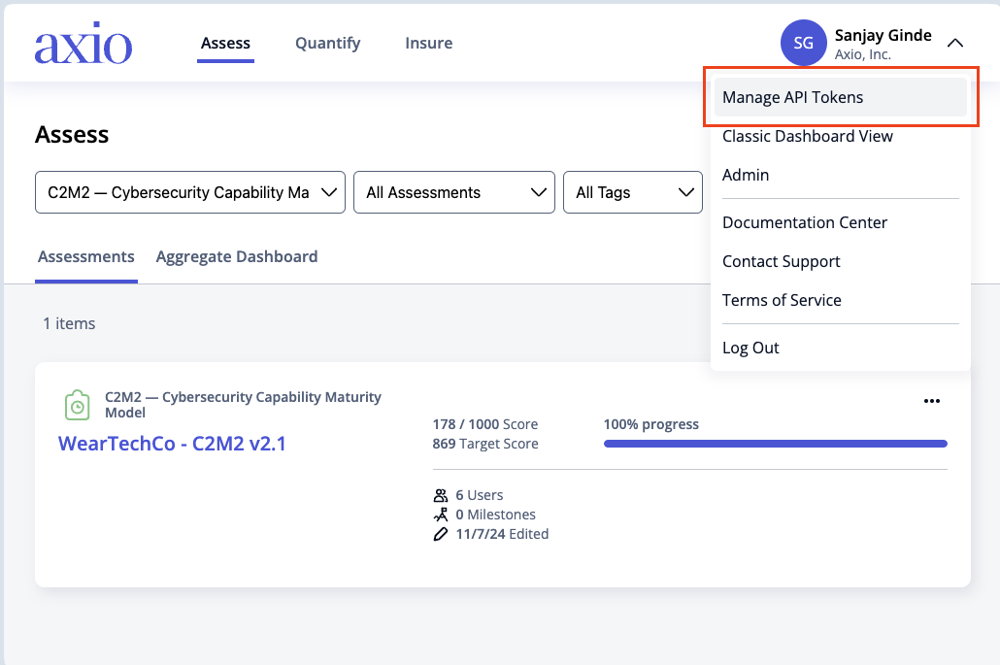
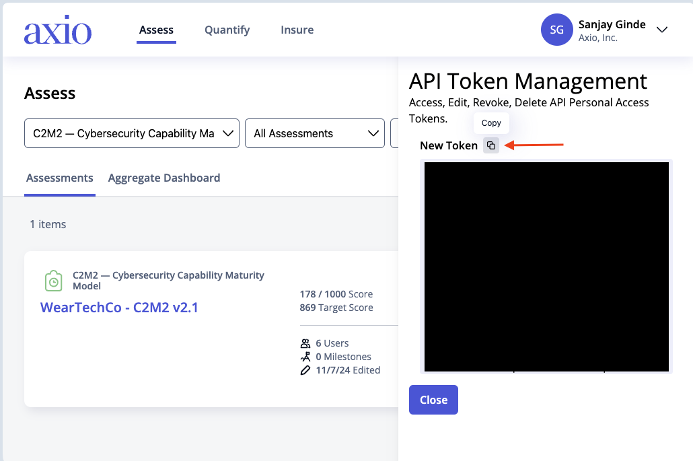
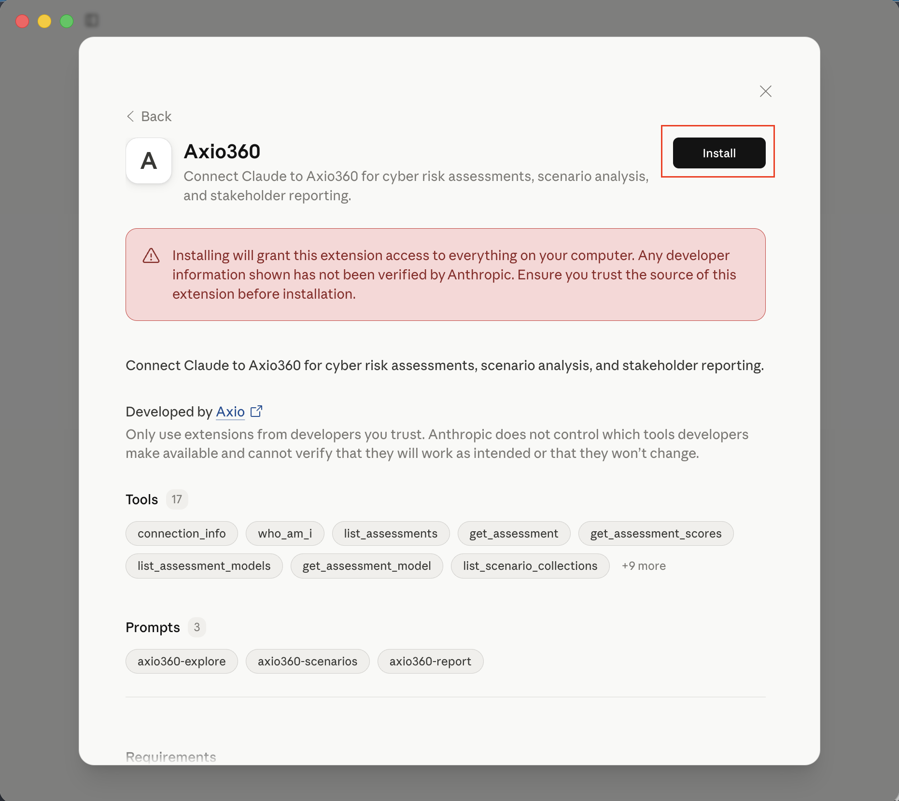
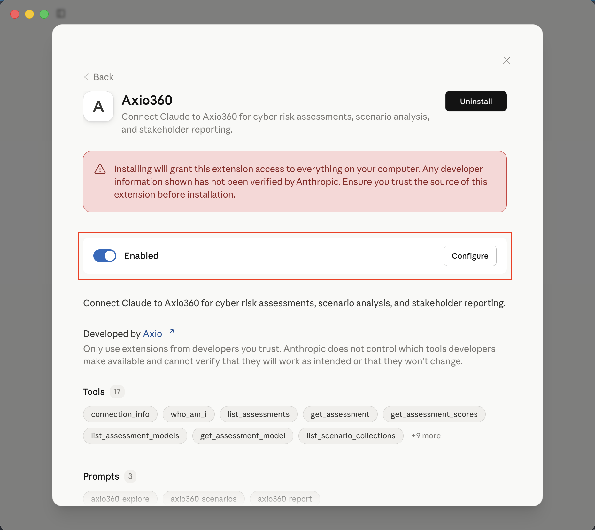
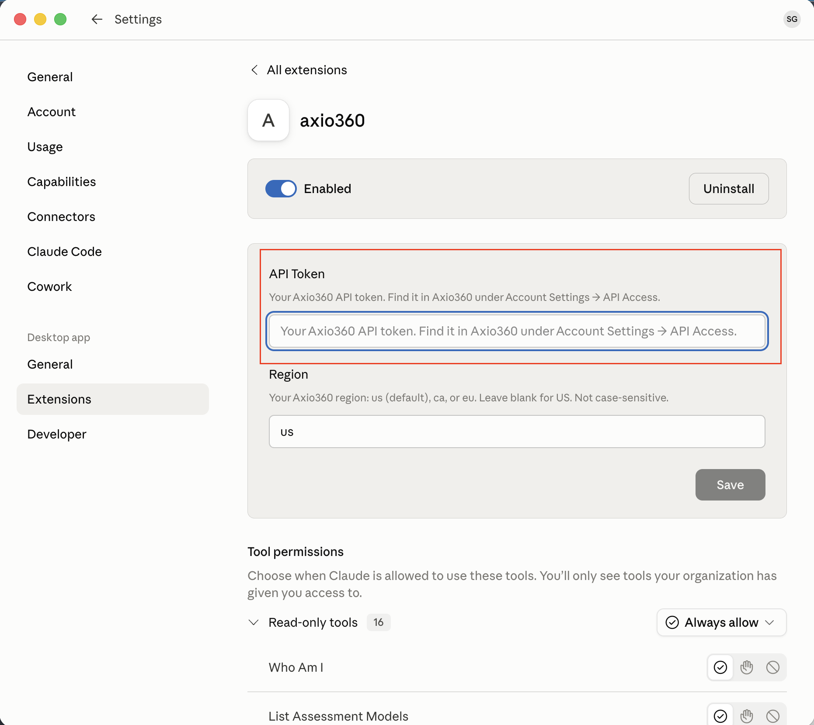
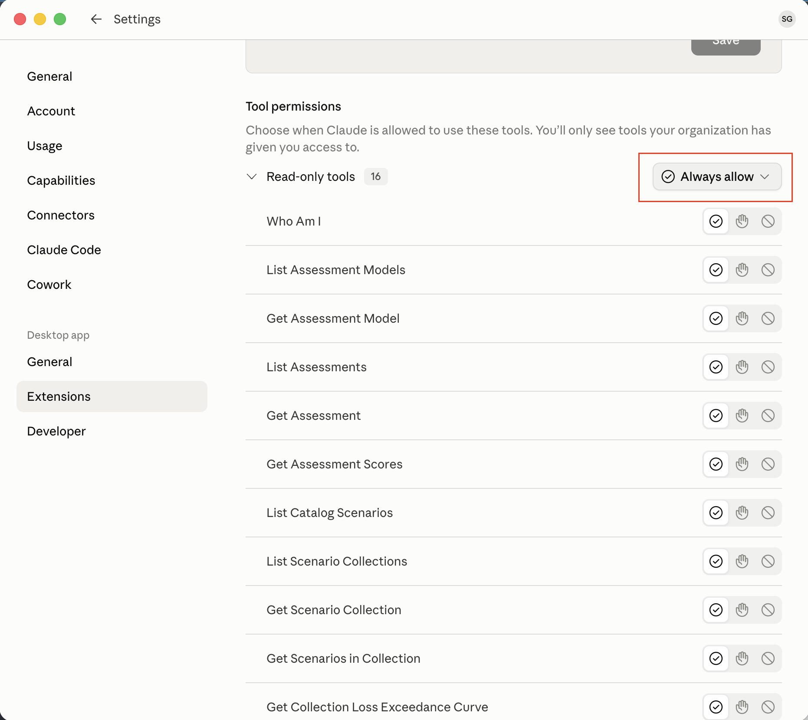

# Getting Started with Axio360 for Claude

This guide walks you through connecting Claude to your Axio360 account so you can explore your cyber risk data, analyze scenarios, and generate reports — all in plain language.

---

## What you'll need

- An active Axio360 account
- [Claude Desktop](https://claude.ai/download) or Claude Cowork
- Your Axio360 API token (instructions below)

---

## Step 1 — Get your API token

1. Log in to the updated Axio360 user interface
2. Go to **Account Settings → Manage API Tokens**

   
3. Generate a personal API token and copy it

   

---

## Step 2 — Install the extension

1. Download **`axio360.mcpb`**
2. Double-click the file — Claude Desktop opens an install dialog

   
3. Click "Install" and ensure that the extension is Enabled. Then click "Configure" and close the dialog.

   
4. Paste your API token into the **API Token** field

   
5. In the **Region** field, enter `ca` (Canada) or `eu` (Europe) if that's where your Axio360 account lives. US customers can leave it blank. (Not case-sensitive.)
6. Under "Tool Permissions", you can configure which endpoints you want to "Always Allow", "Block", or require Claude to ask for approval.
   > Axio recommends **"Always Allow"** for read tools (`list_*`, `get_*`, `who_am_i`, `connection_info`) and **"Needs Approval"** (or Blocked) for write tools (`create_*`, `update_*`) so Claude confirms before creating or changing assessments, scenarios, or estimated values. Permissions can be changed later.

   

### Note

This works for both Claude Desktop and Claude Cowork.

> **If you change the Region later:** click **Save**, then fully quit and relaunch Claude Desktop **and start a new chat session**. The region is applied when the connection starts, so an existing session will keep using the previous region until you open a new one.

---

## Step 4 — Try it out

Once installed, just ask Claude in plain language:

### Assessments

> "Show my assessments"
>
> "What's my current risk score?"
>
> "Rename my FY2025 NIST assessment to FY2025 NIST CSF Q2"
>
> "Create a new NIST CSF assessment named FY2026 Baseline"

### Scenarios

> "What are my top cyber risk scenarios?"
>
> "Show me the loss curve for my ransomware scenario"
>
> "Compare my top three scenarios"
>
> "Update the susceptibility on my ransomware scenario to HIGH"
>
> "Set the expected amount for Number of Servers on that scenario to 500"
>
> "Create a new scenario collection titled 2026 Enterprise Risk"
>
> "Add the catalog ransomware scenario to my 2026 Enterprise Risk collection"

### Reports

> "Generate an executive summary of my cyber risk"
>
> "Write a board-ready report on my current risk posture"
>
> "Summarize my risk for the CISO"

---

## Step 5 — Install the Cowork plugin *(optional, Claude Cowork only)*

The Cowork plugin adds guided slash commands for exploring assessments, analyzing scenarios, and generating reports.

1. Open **Claude Cowork**
2. Click **Plugins** in the sidebar
3. Click **Install Plugin** and select **`axio360.plugin`**
4. The plugin is now active in your workspace

---

## Troubleshooting

### "Not authorized" / your assessments won't load

This almost always means your API token doesn't match the selected **Region**. Your token is issued by one Axio360 region and only works against that region's endpoint.

- Make sure the **Region** field matches where your Axio360 account lives (leave it blank for US).
- If you set a region and get "not authorized," confirm your token was generated from an account in that same region.
- Try leaving **Region** blank (US) and reconnecting. If that works, your token is a US token and you'll need a token from the correct region to use `ca` or `eu`.
- If it still fails, your token may have expired — regenerate it in Axio360 under **Account Settings → API Access** and paste the new one.

After changing the token or Region, click **Save**, then fully quit and relaunch Claude Desktop and start a new chat session.

---

## Need help?

Contact your Axio account team or email <support@axio.com>.
